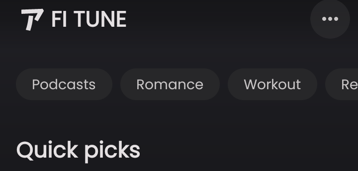
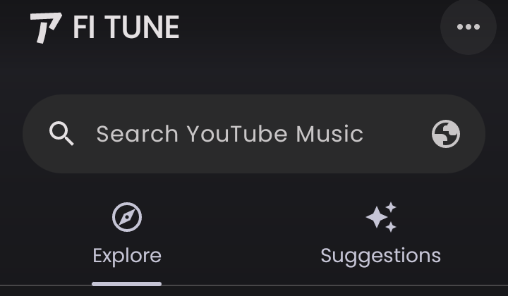

# FI TUNE

<p align="center">
  
</p>

<p align="center">
  <a href="https://github.com/ignite-1018/FI-TUNE/releases/latest"></a>
  <a href="https://github.com/ignite-1018/FI-TUNE/blob/main/LICENSE"></a>
</p>

FI TUNE is an independent, community-developed Android music player derived from [ArchiveTune](https://github.com/rukamori/ArchiveTune). It is not affiliated with or endorsed by the upstream maintainers.

## Screenshots

<p align="center">
  
  
</p>

## Highlights

- Browse, search, and play music; manage queues and playlists.
- Listen to downloaded and cached music, or play audio stored on your device.
- View synced lyrics and customize the player with themes, icon packs, and playback settings.
- Use the equalizer, Android Auto, widgets, and media notifications.

## Download

Get the latest signed APK from [GitHub Releases](https://github.com/ignite-1018/FI-TUNE/releases/latest). FI TUNE requires Android 8.0 or newer. Install a newer official release over your existing FI TUNE installation; uninstalling is not required.

## Build from source

Clone the repository and its submodules, open the project in Android Studio, or install the Android SDK and required toolchains and run:

```powershell
git clone --recurse-submodules https://github.com/ignite-1018/FI-TUNE.git
cd "FI-TUNE"
.\gradlew.bat assembleGmsMobileUniversalDebug
```

### Optional Discord Rich Presence

Rich Presence requires the Discord Social SDK package. Download it from Discord and set `DISCORD_SOCIAL_SDK_ROOT` in the untracked `local.properties` file to the extracted `discord_social_sdk` directory (the directory containing `include\discordpp.h` and `lib\release\discord_partner_sdk.aar`). For example:

```properties
DISCORD_SOCIAL_SDK_ROOT=DiscordSocialSdk-1.10.19337\\discord_social_sdk
```

The SDK package is not included in this repository. Builds without it still work, but Discord Rich Presence is unavailable in those builds. A Discord account linked through FI TUNE's optional OAuth profile feature is not required; users need the Discord app installed and signed in.

### Local configuration

GitHub update checks are enabled by default, and release workflows explicitly enable them. Use these values in an untracked `local.properties` file only when you need to override the project defaults:

```properties
GITHUB_OWNER=ignite-1018
GITHUB_REPO=FI-TUNE
RELEASE_GITHUB_OWNER=ignite-1018
RELEASE_GITHUB_REPO=FI-TUNE
ENABLE_GITHUB_UPDATES=true
TOGETHER_SERVER_URL=https://your-server.example
```

Set `ENABLE_GITHUB_UPDATES=false` only when you intentionally want to disable update checks. The Together server URL is optional and should point to a service you control. Never commit signing keys, passwords, API keys, or other credentials.

The release workflow builds and signs GMS and FOSS APK variants. It requires the persistent Android signing key in repository Actions secrets: `KEYSTORE` (base64-encoded keystore), `KEY_ALIAS`, `KEYSTORE_PASSWORD`, and `KEY_PASSWORD`. Keep secure backups of the keystore and its passwords; future updates for this application ID must use the same signing identity.

## License and attribution

FI TUNE is derived from ArchiveTune and is distributed under the GNU General Public License, version 3. The upstream `LICENSE` and source copyright notices are retained. Changes in this derivative must be marked, and any distributed derivative must also comply with GPL-3.0, including making its corresponding source available.
